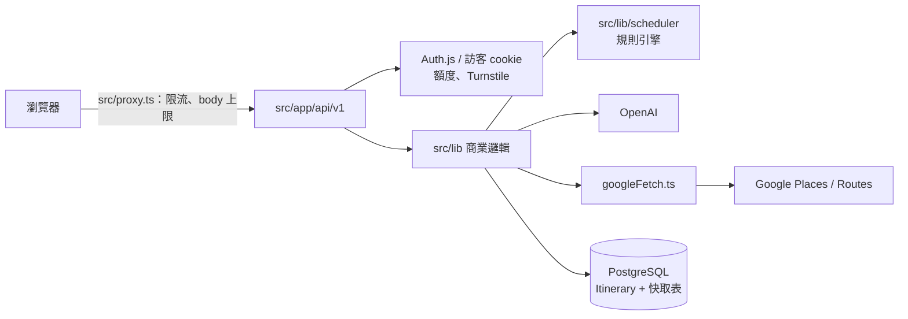
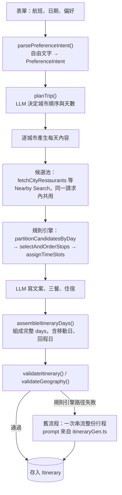

# 架構

## 總覽

Next.js 16 App Router 單體應用，資料存在 PostgreSQL（Prisma；本機 Docker、正式 Neon），行程內容由 OpenAI 與規則引擎共同產生，真實地點來自 Google Places / Routes。`src/app/api/v1/**` 的路由很薄，邏輯幾乎都在 `src/lib/`。

## 使用者與存取

- 只有 Google 登入（`src/auth.ts`，JWT session）。未登入的訪客也能生成，由簽章 cookie 識別、行程會過期；登入時認領訪客行程（`src/lib/auth/guest.ts`）。
- 行程讀寫都檢查擁有權（`src/lib/auth/ownership.ts`）。
- 花錢的操作受三層保護：`src/proxy.ts` 依 IP 與成本等級限流；`src/lib/quota.ts` 依使用者、IP、裝置計算額度，紀錄在 `UsageEvent`；生成前要通過 Cloudflare Turnstile。管理者（`ADMIN_EMAILS`）不受額度限制。另有全站每日呼叫上限（`src/lib/dailyBudget.ts`）與每個 IP 同時只能一個生成的鎖。限流、每日上限與生成鎖存在 Postgres，多個伺服器實例共用（`src/lib/sharedState.ts`，#209）；單元測試用記憶體版本（`SHARED_STATE=memory`）。

## 行程生成主流程

`POST /api/v1/generate-stream` 以 SSE 串流回傳進度。

- 新路徑由 `src/lib/assembleItineraryDays.ts` 串起來，逐城市的生成在 `src/lib/itineraryCityGen.ts`（`generateDayStops`、`generateTransitDayStops`、`generateMealsAndAccommodation` 等）。
- 規則引擎（`src/lib/scheduler/`）全是純函式：決定每天放哪些景點、順序、時段；LLM 只負責文案與偏好解析。
- 舊流程寫在 `generate-stream/route.ts` 裡，prompt 由 `src/lib/itineraryGen.ts` 組成（步調、預算、命名規則等），加上模型沒照規則時的事後修補。它仍是新路徑失敗時的 fallback，不是死程式碼。

## 其他生成入口

- `POST /api/v1/itinerary/[id]/restructure`：「重新規劃行程」精靈唯一的套用端點。前端送出最終的城市順序（新／既有、天數、保留哪些天、鎖定的必去景點），後端重建整個 `days` 並在一個 transaction 內覆寫，這點跟其他逐步修改的路由不同。移動日和回程日一律保留；既有城市的下一站改變時，它的出發移動日視為過期並重新產生。被丟棄的天寫進 `DeletedDay`。
- 單日編輯：`stops/[stopId]/regenerate`、`days/[dayId]/stop-suggestions`、三餐與住宿的 `regenerate`／`select`。每一批顯示給使用者的候選都寫進 `*CandidateLog`。

## 資料模型

- `Itinerary.days`、`Itinerary.config` 是 JSON 字串；`src/lib/db.ts` 的 extension 自動 parse/stringify（`scripts/` 不經過它）。`days` 的形狀見 `src/types/itinerary.ts` 的 `Day`。
- `User`（`isGuest`、`disabledAt`）、`UsageEvent`（額度計算）。
- `RateLimitWindow`、`DailyCallCount`、`GenerationLock`：限流、每日呼叫上限、生成鎖；舊資料由 `scripts/cleanup-expired-guests.ts` 清除。
- `Place`/`PlaceQuery`：查詢字串到地點的快取，唯一入口 `src/lib/placeCache.ts`。
- 行程、候選紀錄、垃圾桶裡的地點座標都附 `coordsFetchedAt`，超過 30 天由 `src/lib/coordsPurge.ts` 刪除，顯示時重新取得（ADR-0006）。
- `DeletedStop`/`DeletedDay`：垃圾桶與復原。
- `*CandidateLog`：每批候選的完整紀錄，供除錯。
- `*Cache`：AI 結果與我們自己的資料（季節亮點、經典一日遊、城市中心沒找到等）的快取，同城市重複生成時不再付費。只記確定的「找不到」，失敗不記（見 `.claude/rules/google-places.md`）。完整欄位以 `prisma/schema.prisma` 為準。
- Google 的候選池、路線、最近車站依條款不能保存（ADR-0004），只在同一請求內共用（`src/lib/requestMemo.ts`），資料庫裡沒有它們的表。`Place` 只有 place ID 與附取得時間的座標。

## 設計原則

- 每個計費的 Google 呼叫都經過 `src/lib/googleFetch.ts`，`MOCK_PLACES` 才能一次換掉。
- 規則與門檻寫成具名常數，放在使用它的模組；文件只引用名稱與路徑。
- 地點比對不直接信任 Google：離城市太遠就標記可疑（`SUSPICIOUS_DISTANCE_KM`，`src/lib/geo.ts`）。
- 驗證分兩層：`validateItinerary.ts` 只看結構、不呼叫外部；`validateGeography.ts` 看座標距離。
