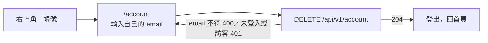

# 刪除帳號

## 一句話

登入的使用者在 `/account` 自己刪除帳號與所有資料，立即生效、無法復原，不需要寫信聯絡。

## 流程

## 規則 / 狀態

| 項目 | 規則 |
| --- | --- |
| 誰可以刪 | 只有登入的 Google 使用者；訪客與未登入一律 401 |
| 確認 | 送出的 email 要與帳號相同（不分大小寫、忽略前後空白），否則 400，什麼都不刪 |
| 刪除範圍 | 使用者資料列、所有行程，以及行程底下的垃圾桶與候選紀錄（資料表 cascade）、該使用者的使用紀錄（`UsageEvent`），在同一個 transaction 裡 |
| 刪除之後 | 頁面呼叫 server action 登出；不登出的話，仍有效的 session 會在下一個請求以 email 重新建立使用者（`src/lib/auth/actor.ts` 的 `withStoredUser`） |
| Google 授權 | 網站沒有保存 Google 的 token，刪除帳號不會撤銷授權；頁面提供 Google 帳戶「第三方連結」的連結 |
| 訪客 | 沒有刪除功能，行程依訪客期限自動刪除 |

## 參數

無。

## 成本

無付費 API。

## 已知限制

- 使用紀錄一起刪除，所以刪帳號再登入會讓額度歸零，同一 IP、裝置的計數也一起清掉；仍有 API 限流、生成鎖、全站每日上限與 Google 每日配額（使用者 2026-10-26 決定，#283）。

## 相關連結

#283、#261
