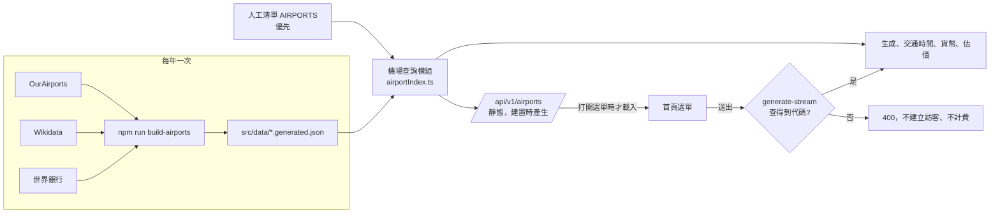

# 機場

## 一句話

使用者能從哪些機場出發、到達，每個機場對應哪個城市、國家、貨幣，到市區要多久，餐費與住宿怎麼估。

## 流程

## 規則

| 項目 | 規則 |
| --- | --- |
| 涵蓋範圍 | OurAirports 有定期航班、有 IATA 代碼的大型與中型機場（`KEPT_AIRPORT_TYPES`），加上人工清單 |
| 人工與生成 | 同一代碼兩邊都有時，城市名、座標、國家、交通時間用人工的；英文名人工有填（`cityEn`）就用人工的 |
| 停用的機場 | 人工清單標了 `replacedBy` 的機場（柬埔寨的 REP、PNH，航班已移到 SAI、KTI）不出現在選單，城市名對應到新機場；保留在清單裡，用舊代碼存的行程照常顯示 |
| 服務的城市 | Wikidata 的服務城市中，距離在 `MAX_CITY_KM` 內的，同國優先，再取人口最多、再取最近；都沒有就用機場所在地與機場座標 |
| 座標 | 用城市中心，不用機場（KEF 離雷克雅維克約 50 公里） |
| 城市名 | 繁中名稱，沒有就英文，再沒有就 OurAirports 的所在地或機場名 |
| 同名城市 | 選單用國家區分；`cityToIata` 遇到不同國家同名不猜，回傳查不到 |
| 貨幣 | Wikidata 的國家貨幣；有多個或沒有時用 `CURRENCY_OVERRIDES`（`scripts/build-airports.ts`）；人工清單的柬埔寨機場用 `CURATED_COUNTRY` |
| 機場到市區時間 | 人工表 `TRANSFER_MINUTES` 有就用；沒有就依機場到城市中心的距離估算 |
| 費用估算 | 物價表有該貨幣就用；沒有就用美元參考價 × 用該貨幣的國家的物價水準 × 匯率，取兩位有效數字；查不到物價水準時不估（門票顯示「未估算」，不是免費） |
| 選單搜尋 | 代碼、中文名、英文名、國家名，不分大小寫與重音；排序：代碼完全相同、名稱開頭相符、名稱包含 |
| 選單載入 | 人工清單隨頁面載入；完整清單打開選單時才下載一次，失敗時只用人工清單；選到的代碼不在人工清單時立刻載入以驗證 |
| 後端驗證 | `generate-stream` 在建立訪客、記錄額度、呼叫任何付費 API 之前，拒絕查不到的代碼 |

## 參數

- 範圍與城市：`src/lib/airportData/build.ts` 的 `KEPT_AIRPORT_TYPES`、`MAX_CITY_KM`；`scripts/build-airports.ts` 的 `MIN_AIRPORTS`、`CURRENCY_OVERRIDES`。已確認（2026-10 的抽查報告）。
- 交通時間：`src/lib/airportTransfer.ts` 的 `TRANSFER_BASE_MINUTES`、`TRANSFER_MINUTES_PER_KM`。用人工表的機場擬合，待校準。
- 選單筆數：`src/app/page.tsx` 呼叫 `searchAirports` 的上限。

## 成本

- 產生資料：免費，不呼叫 Google 或 OpenAI。
- 執行時：查詢都在記憶體，不呼叫外部服務；`/api/v1/airports` 是建置時產生的靜態檔，不含座標。
- 生成到新目的地的 Google 與 OpenAI 用量與其他城市相同。

## 已知限制

- 新貨幣的費用是用物價水準粗估，準確度不如人工物價表（[ADR-0011](../adr/0011-airport-data-from-open-sources.md) 的後果）。
- 熱門路線的附近城市建議（`ROUTE_NEARBY`）只涵蓋人工清單的機場（PLAN-003 非目標）。

## 相關連結

- [ADR-0011](../adr/0011-airport-data-from-open-sources.md)、[PLAN-003](../plans/PLAN-003-any-airport.md)、[資料來源](../data-sources.md)、[更新步驟](../runbook.md#更新機場與國家資料)
- issue：#298、#300、#306
