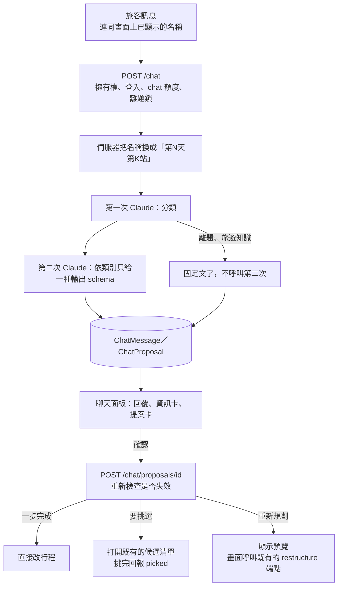

# 行程聊天助理

## 一句話

行程頁右下角的「問助理」：旅客用自然語言問這趟行程，或請助理修改行程；修改一律先變成提案卡，旅客按「確認」才套用。

## 流程

LLM 只看到 `src/lib/chat/context.ts` 組的摘要（日期、城市、時段、停留時間、移動日交通），看不到 Google 的地點名稱、地址或交通時間（ADR-0008）。回覆用「第2天第3站」這類說法，畫面上最新一則回覆再補上名稱。

## 規則 / 狀態

**訊息分類**（`CHAT_CATEGORIES`）

| 類別 | 助理能輸出什麼 |
| --- | --- |
| `itinerary_question` 問行程 | 文字，加上交通資訊卡（畫面從行程資料顯示交通文字，LLM 看不到） |
| `edit` 修改 | 白名單動作的提案卡，一個要求一張 |
| `restructure` 重新規劃 | 城市順序與天數的提案卡 |
| `place_fact` 地點事實 | 該站的「照片與詳情」按鈕，不回答事實 |
| `travel_knowledge` 旅遊知識 | 固定文字「之後會支援」，不算離題 |
| `off_topic` 離題 | 固定文字，計入離題次數；達上限當天鎖住 |

分類不確定時當成問行程（最便宜、不能修改）。

**提案動作**

| 動作 | 確認後 |
| --- | --- |
| 刪除景點、同一天內調整順序、刪除某一餐 | 直接套用；刪掉的景點進垃圾桶 |
| 加回某一餐 | 套用後打開那一餐的候選清單 |
| 換景點、加景點、換餐廳（可帶條件，例如「拉麵」）、換住宿 | 打開既有的候選清單；挑完才算套用 |
| 重新規劃城市與天數 | 顯示前後差異預覽，按下後呼叫 restructure 端點（ADR-0014） |

移到別天、整趟放慢等要求不產生提案，回覆說明怎麼用按鈕或逐天調整。移動日的交通站、訂好位的固定行程、鎖定的天依既有規則拒絕（`src/lib/chat/proposalRules.ts`）。

**提案卡狀態**

| 狀態 | 意思 |
| --- | --- |
| `pending` 待確認 | 顯示「確認」「取消」 |
| `applied` 已套用 | 一步完成的修改已寫入，或挑選、重新規劃已完成 |
| `cancelled` 已取消 | 行程沒有任何改變 |
| `stale` 已失效 | 確認時發現行程已經變了（景點不在、天數對不上），請旅客重問 |

提案只透過條件更新離開 `pending`，所以重複按確認只會套用一次。

**誰能用**

| 身分 | 能做什麼 |
| --- | --- |
| 登入的行程擁有者 | 聊天、確認提案 |
| 訪客（未登入） | 看不到輸入框，提示登入後使用 |
| 其他人看管理者的公開範例 | 唯讀看擁有者的對話（示範對話）；沒有輸入框，提案卡不能確認；沒有對話時不顯示按鈕 |

**輸入框**：Enter 送出、Shift+Enter 換行；注音選字中的按鍵交給輸入法，含注音符號的訊息不送出（微軟注音在 Chrome 有時送出不帶選字標記的 Enter）；↑／↓ 叫回送過的訊息。手機上面板全螢幕，打開候選清單時自動收起。

## 參數

- 每日則數、離題上限：`src/lib/quota.ts` 的 `QUOTAS.chat`（已確認）
- 放進 LLM 的對話則數：`src/lib/chat/assistant.ts` 的 `CHAT_HISTORY_MESSAGES`（待校準）
- 訊息長度、建議問題：`src/lib/chat/constants.ts` 的 `CHAT_MESSAGE_MAX_LENGTH`、`SUGGESTED_QUESTIONS`
- 名稱比對：`src/lib/chat/context.ts` 的 `MIN_MATCHED_NAME_LENGTH`；一次最多送來的名稱數：`src/lib/chat/conversation.ts` 的 `CHAT_MAX_SHOWN_NAMES`
- 選字結束後仍算輸入法的時間：`src/lib/chat/display.ts` 的 `AFTER_COMPOSITION_MS`

## 成本

- 每則訊息呼叫 Claude 兩次（分類、回覆），離題與旅遊知識只呼叫一次；不呼叫 Google。計入 `chat` 額度與全站每日上限；Claude 失敗不存、不扣。
- 確認提案沿用原本的編輯：換景點、換餐廳、換住宿、加景點、重新規劃會查 Google，扣原本的額度，不重複扣 `chat`。
- `MOCK_AI`（`dev:free`、整合測試）的回覆由 `src/lib/mockAi.ts` 依關鍵字產生，只改第 1 天，完全不花錢。

## 已知限制

- 回答地點事實（營業時間、評價）要等 v1.5 接 Google 地圖工具（#363）；店家介紹與旅遊知識要等 v2（#364）。
- 名稱比對只認得畫面上已展開的天；沒展開的天，助理會反問是第幾站（#379）。
- 「重新規劃行程」精靈還在，聊天版驗收後才刪（#365）。

## 相關連結

- 計畫：[PLAN-004](../plans/PLAN-004-itinerary-chat.md)
- ADR：[ADR-0013 伺服器分類與授權](../adr/0013-chat-server-side-authorization.md)、[ADR-0014 聊天取代精靈](../adr/0014-restructure-via-chat.md)、[ADR-0008 LLM 不看 Google 內容](../adr/0008-no-google-content-in-llm-input.md)、[ADR-0004 Google 內容不儲存](../adr/0004-google-maps-content-storage.md)
