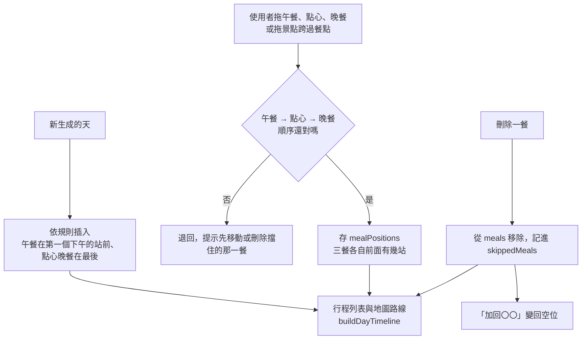

# 餐點的位置與刪除

## 一句話

一天裡的三餐排在哪兩站之間、使用者怎麼調整，以及不想要的那一餐怎麼拿掉。

## 流程

## 規則 / 狀態

| 項目 | 怎麼做 |
| --- | --- |
| 可以拖的餐 | 午餐、點心、晚餐，只能在同一天裡拖。早餐固定第一、小酌固定最後 |
| 拖拉的結果 | 放開時畫面上的順序就是結果，景點跨過餐點也一樣 |
| 餐點順序 | 午餐 → 點心 → 晚餐，不能對調；兩餐之間可以沒有景點 |
| 沒拖過的天 | 沿用規則；只拖過其中幾餐時，其他餐依規則，但不會越過已放好的餐 |
| 時段 | 拖過餐點的天：午餐前是上午、午餐到晚餐之間是下午、晚餐之後是晚上；沒拖過的天依站的位置分配 |
| 交通重算 | 景點順序變了才重算交通；只移動餐點時由排序 API 直接重排時段 |
| 刪除 | 每一餐都可以刪，訂好位的餐（固定行程）除外。刪掉的餐不留空位、不佔順序 |
| 加回 | 當天底下的「加回〇〇」變回「選擇〇〇」空位；直接挑一家也會加回 |
| 刪掉景點後 | 餐點前面的站數超過當天站數時，排在最後 |
| 地圖 | 路線用同一份順序；沒有座標的站不在地圖上，位置仍以整天的站數計算 |

## 參數

- 可以拖的餐與順序見 `src/lib/dayTimeline.ts` 的 `MOVABLE_MEALS`。

## 成本

- 拖餐點、刪除、加回都不呼叫 Google 或 OpenAI。
- 景點順序改變時，跟以前一樣重新計算交通（Routes）。

## 已知限制

- 交通的文字是「從上一個景點」算起，不是從餐廳算起。
- 早餐與小酌不能拖。

## 相關連結

[ADR-0010](../adr/0010-draggable-meals.md)、[移動日](transit-days.md)、#287、#292
