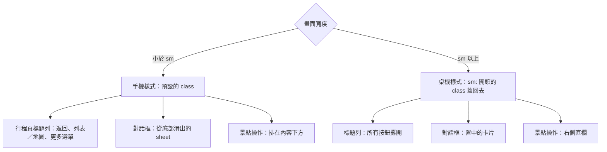

# 手機版排版

## 一句話

同一個網址在手機瀏覽器（寬 375～430px）上怎麼排版、怎麼用手指操作，同時讓桌機畫面維持原樣。

## 流程

## 規則 / 狀態

**斷點**：mobile-first。不加前綴的 class 是手機樣式，`sm:`（Tailwind 預設 640px）以上加回桌機樣式；行程頁側欄沿用原本的 `lg:`。不在 JS 偵測裝置。

| 項目 | 手機（小於 `sm`） | 桌機（`sm` 以上） | 在哪裡 |
| --- | --- | --- | --- |
| 頁面上下外距 | 縮小 | 原本的大外距 | 各頁的 `py-6 sm:py-16` |
| 行程頁標題列 | 返回、列表／地圖切換、「更多」選單（設為公開、複製連結、下載 PDF、垃圾桶、已儲存的行程） | 所有按鈕攤開 | `ViewContent.tsx` 的 `headerMenuItems`、`MoreMenu` |
| 路線麵包屑 | 換行 | 一行，超出時橫向捲動 | `ViewContent.tsx` |
| 對話框 | 從底部滑出、內容自己捲動、關閉鈕固定在頂端、底部留安全區 | 置中卡片（垃圾桶靠上） | `ResponsiveDialog` |
| 景點的編輯、換一個、移到別天、刪除 | 排在內容下方一列 | 右側直欄 | `SortableStop` 的 `renderActions("below" \| "side")` |
| 刪除景點的復原提示 | 固定在畫面底部 | 同左 | `EditableItineraryCard.tsx` |
| 首頁城市選單 | 一欄 | 兩欄 | `page.tsx` |
| 固定行程的場地與城市 | 上下排 | 左右排 | `FixedEventsEditor.tsx` |

**觸控規則**

| 規則 | 做法 |
| --- | --- |
| 可點元素至少 44×44px | 手機上加大 padding，`sm:` 縮回原尺寸；文字連結用負 margin 加 padding 擴大範圍、不推開版面 |
| 不依賴 hover | 只在滑鼠移過才出現的操作（行程列表的刪除）用 `pointer-coarse:` 在觸控裝置直接顯示 |
| iOS 點輸入框不自動放大 | 小於 640px 時文字輸入框、下拉選單、文字區字級 16px（`globals.css`） |
| 拖拉不誤觸 | 長按才開始拖拉，一般上下滑動是捲動；設定見 `useItinerarySensors` |
| 唯讀頁不顯示編輯提示 | `[data-readonly]` 底下隱藏拖拉把手（`data-drag-handle`）與「可拖曳排序」說明 |

**共用元件**

- `ResponsiveDialog`：行程頁對話框的外殼（地點詳情、垃圾桶）。Escape 與點背景關閉、鎖住背後頁面捲動。內容本身已有關閉鈕時用 `showCloseButton={false}`。
- `MoreMenu`：「⋯」按鈕加選單，項目可以是動作或連結；點外面或按 Escape 關閉。

## 參數

斷點用 Tailwind 預設值；長按拖拉的延遲與容許位移見 `src/hooks/useItinerarySensors.ts` 的 `TouchSensor` 設定（已確認）。

## 成本

無。只改排版，不呼叫任何 API。

## 已知限制

- 只針對直向手機與桌機設計；平板（640～1023px）與橫向手機只確認不破版（#358）。

## 相關連結

- 計畫：[PLAN-006](../plans/PLAN-006-mobile-layout.md)，父 issue #344
- 刪除的復原提示固定在畫面底部：#330
