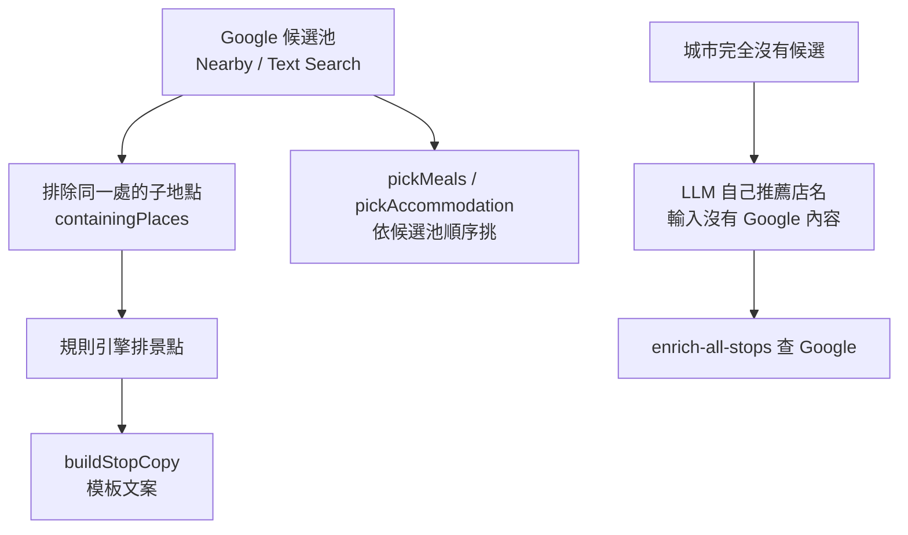

# 地點文案與三餐住宿的挑選

## 一句話

行程裡每個 Google 地點旁邊寫什麼、三餐和住宿選哪家，全部由規則決定，不讓 LLM 拿 Google 的資料去寫或選。

## 流程

## 規則 / 狀態

| 項目 | 怎麼做 |
| --- | --- |
| 景點文案 | 主題日的第一站「今天的〇〇從這裡開始。」；整天行程的最後一站「今天的最後一站。」，之後還有固定行程（例如晚間點燈的季節景點）時不加；其他站留白。移動日、出發日不加註記 |
| 程式的實用說明 | 照舊保留，例如「一日遊：從東京搭火車約 1.5 小時到箱根」「開場前在東京巨蛋附近用餐」 |
| 地點本身的介紹 | 不寫。使用者點「照片與詳情」看 Google 自己的內容（ADR-0005） |
| 三餐 | 依候選池順序挑第一家沒用過的店；同一天、隔天不重複，候選用完才重複，挑來過最少次的；點心照飲料輪替；晚餐盡量避開午餐的料理類型（籠統的 `restaurant` 不算） |
| 移動日的早餐 | 出發城市多挑一天的餐點，只取那天的早餐（[移動日](transit-days.md)、ADR-0009） |
| 住宿 | 住宿候選排第一的那家；「區域」填城市名 |
| 候選池的順序 | 建池時就依預算、飲食限制、親子、獨旅、帶狗、晚起、溫泉排好（`fetchMealLodgingPools`） |
| 同一處的子地點 | 子地點的 `containingPlaces` 有池中的主地點、相距在距離上限內、名稱開頭不同，且主地點不是公園類、子地點不是獨立目的地，才不進候選池（和平鳥居併入箱根神社，東大寺不併入奈良公園） |
| 景點建議 | Google 候選用固定文字「靠近您行程中的景點。」，停留時間用規則引擎的對照表；找不到候選時 LLM 自己提建議，當天的名稱只在回應後過濾 |
| 店名 | 顯示 Google 以 `zh-TW` 回傳的名稱，沒有中文就顯示原文 |

## 參數

- 子地點的距離上限見 `src/lib/scheduler/placeCandidatesToStopCandidates.ts` 的 `PART_OF_MAX_KM`，公園類與獨立目的地類型見同檔的 `AREA_TYPES`、`DESTINATION_TYPES`（待校準：只以 8 組實測決定）。
- 餐點重複間隔見 `src/lib/mealLodgingPicks.ts` 的 `MIN_REPEAT_GAP_DAYS`；不算同類的料理類型見 `GENERIC_FOOD_TYPES`（已確認）。

## 成本

- 生成時的文案、補文案、三餐住宿挑選、店名翻譯都不再呼叫 OpenAI。
- `containingPlaces` 加在候選查詢的 Pro field mask 裡，不多付錢。
- 使用者點「照片與詳情」時，Places UI Kit 每打開一次計費一次。

## 已知限制

- 同一景點的中文、英文名稱各一筆時抓不到，可能排成兩站（#272）。
- 列表上大多數站沒有文案，看不出地點特色。
- Google 沒有中文名稱的店顯示原文（#185）。

## 相關連結

[ADR-0008](../adr/0008-no-google-content-in-llm-input.md)、[ADR-0004](../adr/0004-google-maps-content-storage.md)、[ADR-0005](../adr/0005-place-display-hybrid.md)、[PLAN-002](../plans/PLAN-002-llm-without-google-content.md)、#262、#227
