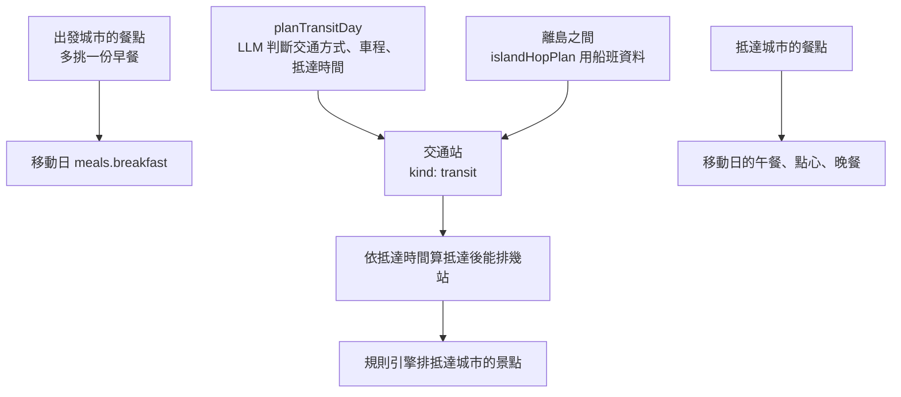

# 移動日

## 一句話

多城市行程裡從一個城市換到下一個城市的那天，怎麼排交通、三餐與抵達後的景點。

## 流程

## 規則 / 狀態

| 項目 | 怎麼做 |
| --- | --- |
| 交通站 | `stops` 裡的一站，`kind: "transit"`。畫面顯示成虛線框的交通列，不能拖拉、換一個、移到別天或刪除，不佔景點編號 |
| 其他景點 | 可以拖到交通站前面（出發城市）或後面（抵達城市） |
| 早餐 | 出發城市的 `meals.breakfast`，跟其他天一樣由規則挑選 |
| 午餐、點心、晚餐 | 抵達城市的餐點 |
| 重新規劃產生的移動日 | 抵達城市這次本來就要查候選時（新城市、或有新增天數的城市），多挑一天給移動日的午餐、點心、晚餐；沒查的話留空位。早餐一律留空位，不為它查出發城市 |
| 重新計算交通 | 交通站保留 LLM 寫的車程；交通站後面第一站寫「抵達〇〇後出發」 |
| 補資料 | 跳過交通站，不拿交通的文字查 Google |
| 舊行程 | 沒有 `kind` 的舊資料，用「移動日、沒有 placeId、不是固定行程、名稱含『前往』」辨認（`isTransitStop`） |

## 參數

- 沒有回傳抵達時間時的預設值見 `src/lib/itineraryCityGen.ts` 的 `DEFAULT_ARRIVAL_MINUTE`。
- 離島上下船的準備時間見同檔的 `ISLAND_BOARDING_MINUTES`。

## 成本

- 每個移動日呼叫 OpenAI 一次（`planTransitDay`），離島之間不呼叫。
- 出發城市多挑一份早餐用現有的候選池，不多查 Google。
- 重新規劃只用這次本來就查的候選，不為移動日多查。
- 補資料跳過交通站，比以前少一次 Text Search。

## 已知限制

- 舊行程靠名稱辨認交通站，名稱沒有「前往」的會被當成一般景點。
- 規則引擎失敗時的整段 LLM 備援仍會寫早餐站，交通站靠形狀辨認。
- 重新規劃產生的移動日沒有早餐，抵達城市沒有新增天數時其他餐也是空位，要使用者自己挑（#295；#290 決定不為此多查 Google）。

## 相關連結

[ADR-0009](../adr/0009-transit-leg-as-pinned-stop.md)、[ADR-0008](../adr/0008-no-google-content-in-llm-input.md)、[地點文案與三餐住宿的挑選](place-copy-and-meals.md)、#286、#290
