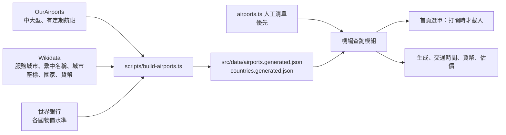

# PLAN-003：機場不再受固定清單限制

## 目標

出發地與目的地只能從 `src/lib/airports.ts` 的 `AIRPORTS` 挑（約 100 個國際機場），朋友想去冰島就找不到（#298，KEF 已個別補上）。改成涵蓋全世界有定期航班的中大型機場，每個機場都有中文城市名（查不到時顯示英文）、市中心座標、國家、貨幣與費用估算，不再靠人工一個一個補。

## 非目標

- 小型機場、沒有定期航班的機場
- 台灣國內行程的地點（`TW-xxx`）與離島：維持人工清單
- 熱門路線的附近城市建議（`ROUTE_NEARBY`）擴充到新機場
- 現有人工清單的資料改用外部資料覆蓋：人工的中文名與座標比較準，維持優先
- 費用估算的準確度校準：新貨幣是粗估

## 驗收條件

- 選單的搜尋框能用 IATA 代碼、中文城市名、英文城市名找到中大型機場（例如 `LIM`、`Lima`、`利馬` 都找得到利馬）
- 選到清單外的機場可以送出生成，不會被前端或後端的驗證擋下
- 每個機場都有：城市名（中文，沒有就英文）、國家中文名、市中心座標、貨幣代碼、機場到市區的時間
- 人工清單裡的機場，城市名、座標、交通時間與現在完全相同
- 物價表沒有的貨幣，餐費、門票、住宿仍有估算；國家沒有物價資料時顯示「未估算」，不是 0
- 首頁初次載入不因為機場資料變慢：完整清單在打開選單時才載入
- 產生資料的腳本可以重跑，每年更新一次的步驟寫進 runbook

## 邊界情況

- 同一城市有多個機場（倫敦 LHR、LGW、STN）：各自列出，顯示「倫敦（LGW）」
- 機場離服務的城市很遠（KEF 離雷克雅維克 50 公里）：座標用城市的，不用機場的
- 不同國家同名城市（美國與英國的「波特蘭」、「伯明罕」）：中文名後加國家區分；以中文城市名反查機場代碼（`cityToIata`）遇到同名時不猜，回傳查不到
- Wikidata 查不到中文名：顯示英文城市名；查不到服務城市：用 OurAirports 的 `municipality` 與機場座標
- 國家沒有世界銀行物價資料（例如北韓）或匯率 API 沒有該貨幣：該國不估算
- 已存的舊行程：機場代碼不變，讀取時照常查得到
- 資料來源改版或下載失敗：腳本失敗就停，不覆寫已提交的資料檔

## 成本

- 產生資料：OurAirports、Wikidata、世界銀行都免費，不呼叫 Google 或 OpenAI。
- 執行時：清單外的機場第一次被用到時，`getCityCenter` 已有市中心座標就不查 Google；沒有座標時才會查一次（與現在相同）。
- 驗證：用 `dev:free` 測選單與送出，免費。實際生成一趟新目的地（例如利馬）會呼叫 Google 與 OpenAI 各約一趟生成的量，跑之前先問（R1）。

## 設計摘要

資料來源的選擇見 [ADR-0011](../adr/0011-airport-data-from-open-sources.md)。

- **資料檔**：腳本把三個來源合成兩個 JSON 提交進 git。機場：代碼、城市名（繁中／英文）、國家代碼、城市座標、機場座標。國家：中文名、貨幣、物價水準。執行時不連外部資料來源。
- **查詢模組**：`iataToCity`、`getIataCoords`、國家名、貨幣、交通時間都改從同一個模組查，人工清單優先，生成資料補上。取代 `IATA_COUNTRY_ZH`、`IATA_CURRENCY` 兩張平行的表。
- **交通時間**：人工表沒有的機場，依機場到城市中心的距離估算（參數放在程式碼）。
- **費用估算**：物價表沒有的貨幣，用美元的參考價 × 該國物價水準 × 當天匯率（現有的 `exchangeRate.ts`）。
- **選單**：現有的搜尋框加上英文城市名比對；完整清單用動態載入，打開選單時才下載。前端與後端都改用查詢模組驗證代碼。
- **授權**：世界銀行資料是 CC BY 4.0，要在網站上標示出處（放在隱私權頁或頁尾）；OurAirports 是公有領域、Wikidata 是 CC0，不用標示。

## 任務拆解

1. （#301）產生資料的腳本與資料檔（OurAirports + Wikidata + 世界銀行），含抽查報告：中文名覆蓋率、座標與機場距離過遠的清單
2. （#302）機場查詢模組：人工清單優先、合併生成資料；改寫 `iataToCity`、`getIataCoords`、`cityToIata`（同名不猜），國家名與貨幣改從模組查
3. （#303）交通時間的距離估算，與物價表沒有的貨幣用物價水準估價
4. （#304）首頁選單：英文名搜尋、動態載入、前後端驗證改用查詢模組
5. （#305）世界銀行出處標示；`docs/data-sources.md`（新建）、`docs/runbook.md` 的年度更新步驟、README 的腳本說明

## 完成後遷移清單

- [x] 功能頁：docs/features/airports.md
- [x] ADR：docs/adr/0011-airport-data-from-open-sources.md
- [x] docs/data-sources.md、docs/runbook.md
- [x] glossary 新詞（機場查詢模組、物價水準）
